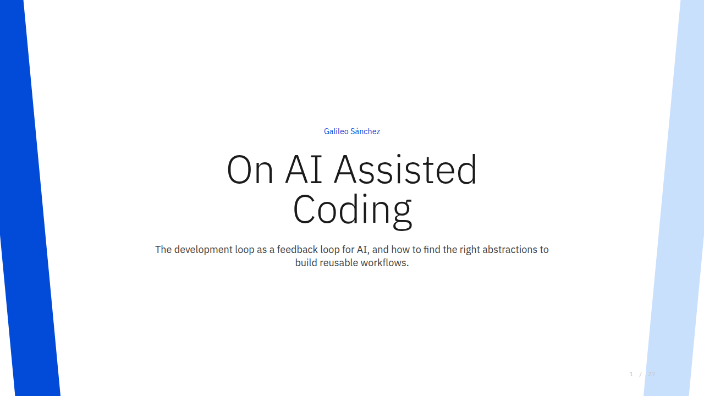
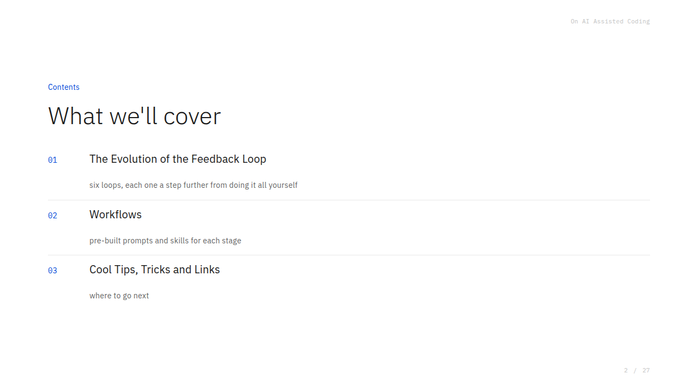
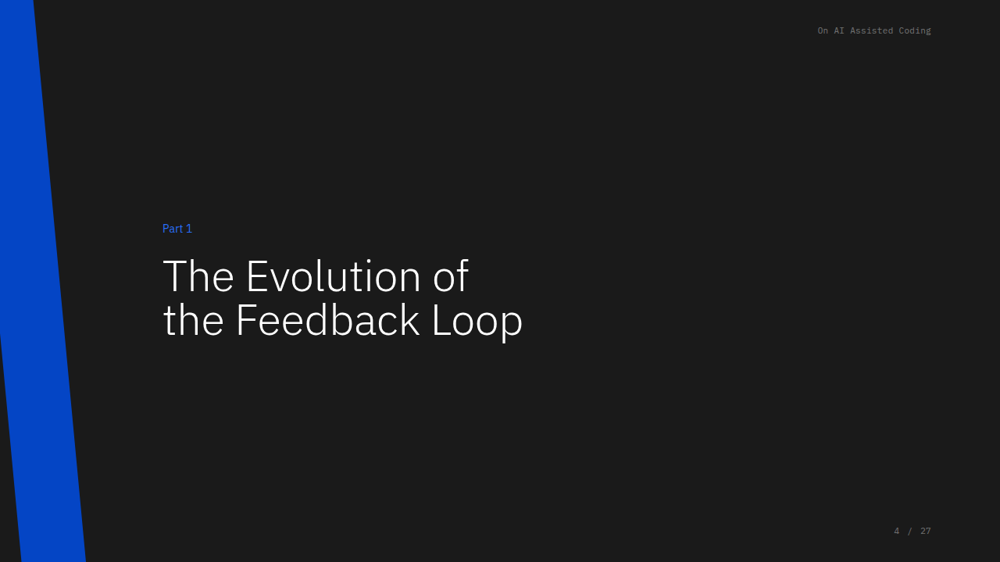
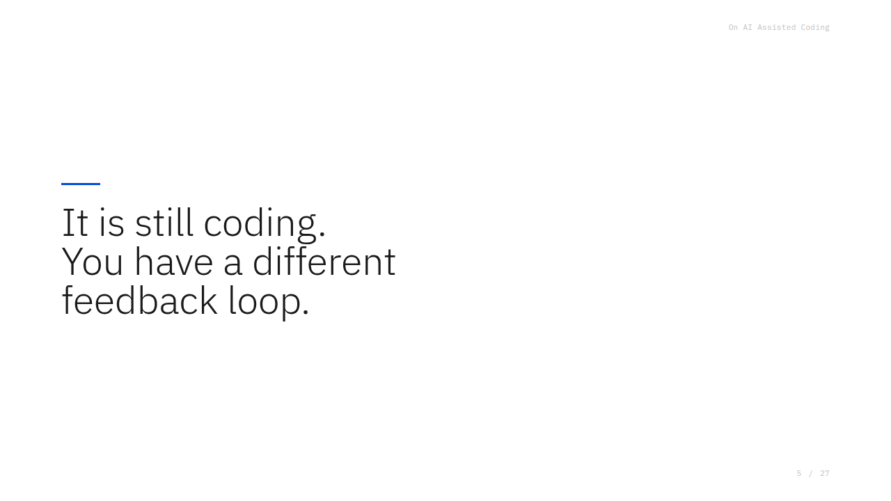
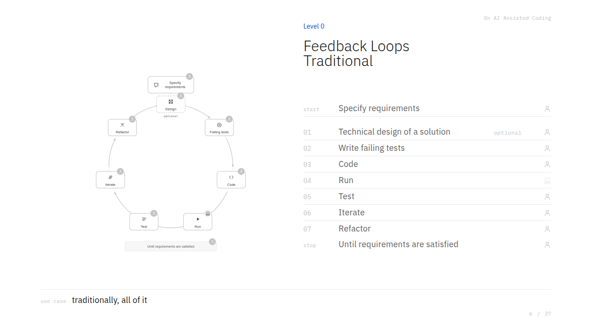
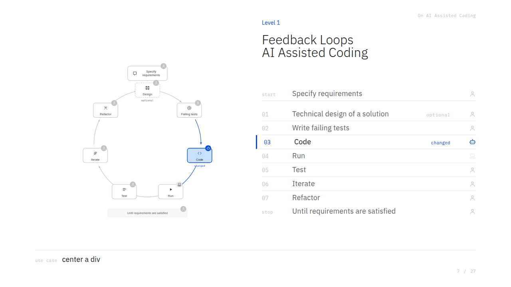
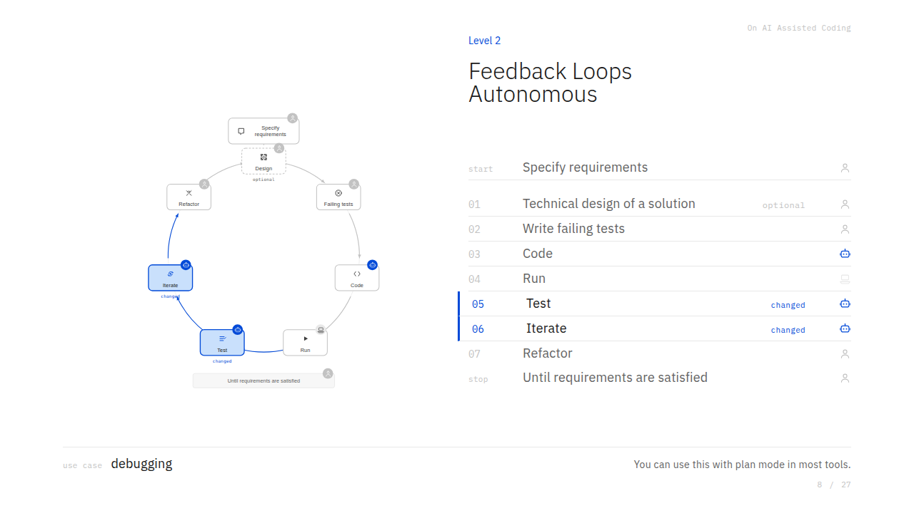
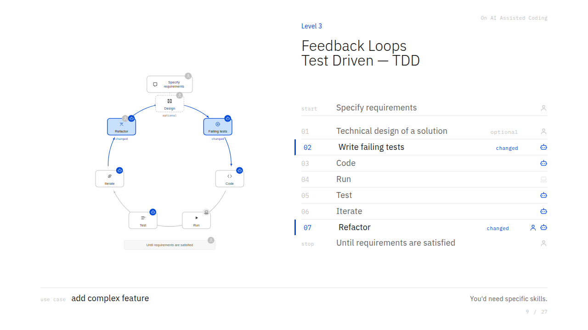
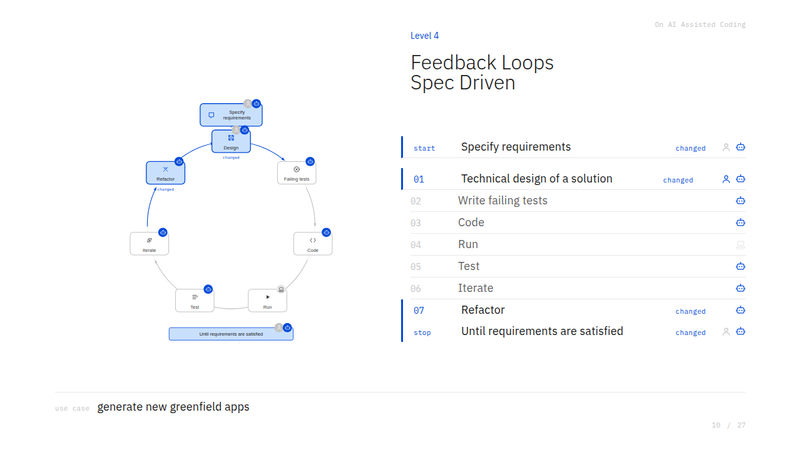
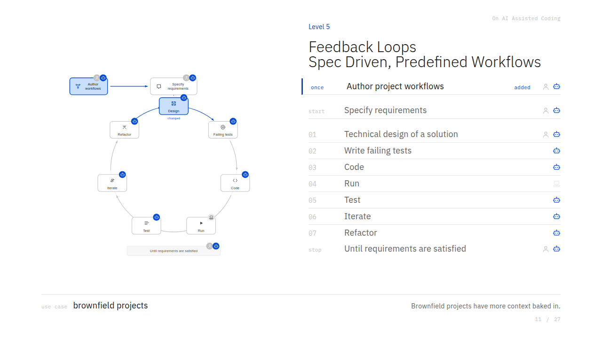

> This is part 1 of three, from a talk I gave on how my coding loop changed this year. [Part 1](/on-ai-assisted-coding-part-1/) covers the feedback loop, [part 2](/on-ai-assisted-coding-part-2/) covers workflows, and [part 3](/on-ai-assisted-coding-part-3/) covers everything else. The slides are [here]({{ site.baseurl }}/presentations/ai-assisted-coding-intro/).

My name is Galileo, and I've been writing down my experiences on how my coding-assisted flow evolved this year. What you'll see now is a condensed summary. We'll start with a conceptual walkthrough of the evolution of the feedback loop.

The feedback loop is what every developer does every day: you open an IDE, find out what you need to do today, from Jira, from Linear, from a Slack message, from an incident, and you work with the computer to fix the system. That can happen at any level: front-end, back-end, infrastructure. In the end, you get a symptom, write a piece of code, validate that the code fixes it, and go through hoops to deploy it to production. The shape of those hoops changes from setting to setting, and AI can intervene and help at each step.

Once you can describe your loops, "when I'm debugging I do it this way; when I implement a feature I do it this way," and the minor details like where work originates (bug reports via Slack or an incident channel, features via a Jira ticket), you can build workflows around them. I'll also share some tips and tricks: some just have a wow factor, and some are genuinely useful.

## The spectrum: manual to harness engineering

I've divided how you use AI in these loops into three broad stages: very manual, somewhat agentic, and harness engineering.

**Manual.** You're still writing the code, in one of two ways. Either you expect your IDE to do code completion (a comment like "I want a function that takes Y and returns Z using such-and-such algorithm," then you wait for a suggestion from Copilot, Windsurf, Cursor), or you get more ambitious: copy a whole service into a chat, tell ChatGPT or Claude how you want it changed, and paste the result back into your IDE. Still manual, but AI-assisted. This is how most people started about a year ago.

**Agentic.** You use the IDE's agent systems. You chat with the agent, give it context ("pull the controller and the renderer layer; read my domains and entities"), and ask for a function, a new endpoint, a REST or GraphQL resolver, with tests. You write a bigger description and it makes in-file changes, but you're still in the IDE, iterating with the agent.

**Spec-driven.** This is more hands-off. You say "here's the feature I want, explore my code base and come up with a plan." You review the plan, a description of the code that will change, approve it, and it manipulates the files, runs the code and tests, and comes back with results. Then you might do a manual check, or submit for review.

**Vibe-coding** sits further along the "how hands-off are you" scale. You just chat, "I want this app to do X and Y," try the app, click the buttons, and give feedback ("I don't want this button this way," "this file gets corrupted when I save"). You're not looking at the code anymore.

**Frameworks.** You take the spec-driven approach, reviewing plans and intended execution, and put it into a framework. There are published ones like SpecKit and Conductor that walk you through every step: "hey, SpecKit, let's define a new feature," and it asks questions, you answer, and you monitor and babysit the agent until you submit an MR.

**In-house workflows, or harness engineering.** Eventually the pre-built frameworks don't quite fit. Maybe you're on GitLab but SpecKit assumes GitHub Actions; maybe you deploy with CDK and Terraform, not what it expects. So you hack SpecKit or Conductor to work your way. Or you're opinionated about clean architecture and want the review step to enforce component separation. This is when you start building your own in-house workflows.

### Where the team sits

> **One attendee described their team's practice:** most of us are around level five or six. We get a product brief, make a high-level plan, break it into tickets with AI, have the tickets implemented, and approve the implementation plans. The one thing we don't skip is reading the diff. Even when I don't check it locally, I open a draft MR and read every line, because the trust isn't quite there yet.

That's very sensible. And by pushing skills to your repo, you're already testing the waters of harness engineering: a pre-made workflow is just a skill that delegates to sub-skills you've tried and tested with your own style and infrastructure. So you're between six and seven. You'll still read the diffs, especially if you're diligent, but it can go faster.

## Part 1: The Evolution of the Feedback Loop

It is still coding. What you have is a different feedback loop.

The spectrum I just walked through, manual to agentic to harness engineering, is one way to slice this. The loops below are a different slicing of the same thing: six loops, each one a step further from doing it all yourself, described by which step moves from the human to the bot. Don't try to line the eight levels of the temperature check up one-to-one with the six loops; they're two different cuts.

### Level 0, Traditional

This is the loop before any of this. You specify the requirements, design the solution, write the failing tests, write the code, run it, test it, iterate, refactor, and you decide when the requirements are satisfied. The only thing the machine does is run. Traditionally, all of it is yours.

### Level 1, AI Assisted Coding

One step moves: the code step. You still specify, design, write the failing tests, and you still test and iterate and refactor yourself. The bot writes the code. Use case: center a div.

### Level 2, Autonomous

Now the test and iterate steps move too. If you let the AI write the code and then run it, checking test output, or whatever signals failure, it works faster, because you don't have to be in the loop. Code that looks right still has to be exercised; if the AI exercises it and learns from its own mistakes, that's faster than you steering every step. The use case is debugging, and you can use this with plan mode in most tools.

### Level 3, Test Driven

The natural next idea: **let the AI write failing tests first**. TDD works better with AI because you want a closed feedback loop as early as possible. It's also easier to review: reading a test plan ("POST to this endpoint gives 200 with this response shape; bad request gives 400") is much easier than reading how it intends to edit each controller, service, and file.

But how do you validate the test? At this stage you still read the tests. As you go further, you notice that tests come out of **requirements**, so the question becomes: can I consistently get good tests out of a well-expressed set of requirements? That's roughly where I am now. At first you validate the tests. Once requirements map cleanly to tests, you validate the requirements first.

The use case here is adding a complex feature, and you'd need specific skills for it.

### Level 4, Spec Driven

Here the human and the bot share every step, including specifying the requirements and the technical design, and the refactor becomes the bot's.

A tease for later: use structured-English frameworks, **Gherkin** and **EARS** (Easy Approach to Requirements Specification), to specify requirements; they map cleanly into good tests. Depending on the feature's size, you may also derive a **technical design** from the requirements, because by now you're not making a single-file change. You're adding a resolver, a REST endpoint, or a new screen, and you need to think about queues and load balancing. So you both define requirements and increase the scope you tackle as one unit of work per sprint, still decomposed into tickets, but iterated faster and more consistently.

Getting the AI to prod you with "what happens if this or that?" and to generate edge cases helps you catch cases you'd miss alone or with one colleague. So now the flow is: write specs, review and refine them with AI, prepare technical designs, and let the loop prepare a solution.

The use case is generating new greenfield apps. You can use plan mode, or start using more complex frameworks.

**The refactor step.** The first code that passes the tests is usually full of shortcuts: unnamed constants, 200-line functions. Keeping the code base at a certain quality also helps the AI work faster later. What helps humans work faster helps the machines too. Over time you learn what the AI usually gets wrong, what it usually gets right, and what you can trust it with in a given project. Part of this is improving your local documentation, so your conventions, including how you add services and implement your infrastructure, are encoded in the repo, so the AI doesn't repeat the mistakes it makes when freshly onboarding.

### Level 5, Spec Driven with Predefined Workflows

The change here is a step that happens once, before the loop: you author the project's workflows. Along the session timeline, the progression looks like this.

- **Manual correction.** You correct the agent constantly ("no, let's not do that; look at this file instead") because you still know the code better.
- **Self-correction.** You give it a plan and it self-corrects against it, the diamonds in the diagram. It knows in advance which file is right, and when it deviates it returns to the plan. You still steer occasionally, because testing and infrastructure have quirks.
- **Encoded workflows.** Once you know the fixes you always end up making, you encode them into a workflow of gated checks. A workflow is a bit "dumber," so each task must be more contained, but then you can let it run all the way to done. Every step needs a clear definition of done, especially the end goal. That's why requirements matter.

The use case is brownfield projects. Brownfield projects have more context baked in.

### Documentation and context windows

> **From the audience:** I've tried putting good coding-standard docs in specific subdirectories so the AI reads the local conventions, but we don't have much of that. We also haven't experimented with loops beyond what Claude or Cursor do automatically. As your loops get more sophisticated, does it balloon your context windows?

It does, but timing helped. Claude launched the one-million-token context window while we were experimenting, so a full autonomous run still fits. You blow past the window more easily when driving manually; an authored workflow stays within bounds. It's an art to scope a single ticket: push it to 100% of the window and it gets dumb. Harness workflows are more token- and context-intensive per task, so run one task per session and learn to scope each task to fit one context window.

> **From the audience:** So smaller-scope tasks, and the loop gives better output. It uses more context, but staying small keeps it inside the window.

Right. And once your workflows can run with about 80% less oversight, where you only do MR reviews and QA, click around a staging deploy and then submit, you can use your subscription tokens overnight. Set up an orchestrator bot that pulls tickets; during the day you prepare specs for three to five tickets, and let it run overnight on tokens you aren't using. Claude has five-hour limits (Codex may differ); by morning you have a fresh session for spec work, and the overnight sessions have reset. It definitely uses far more tokens.

[Part 2](/on-ai-assisted-coding-part-2/) walks through a full workflow run, end to end.
