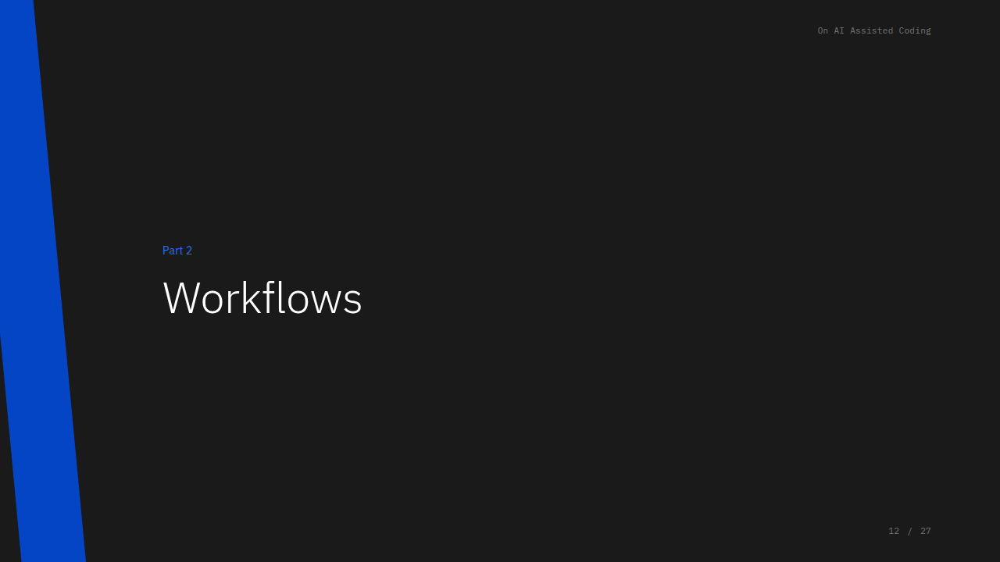
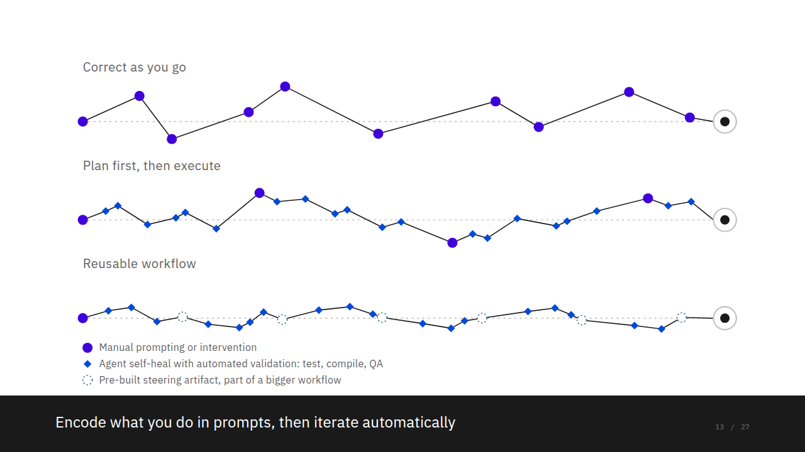
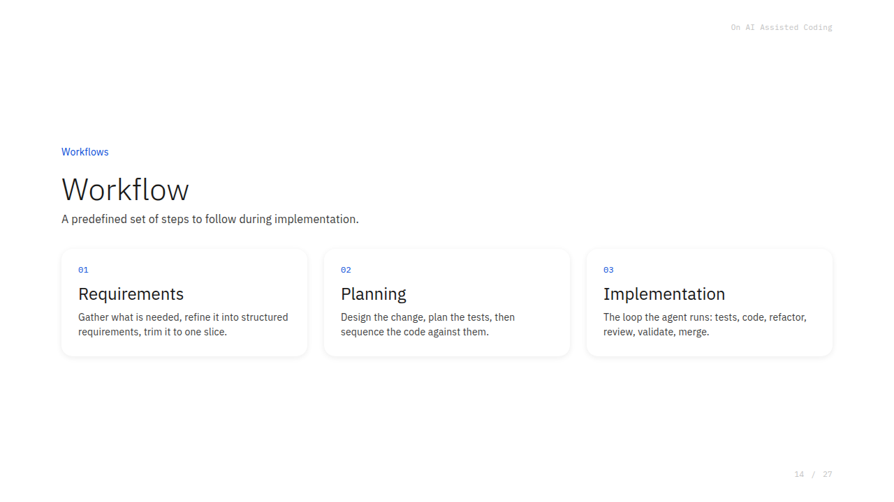
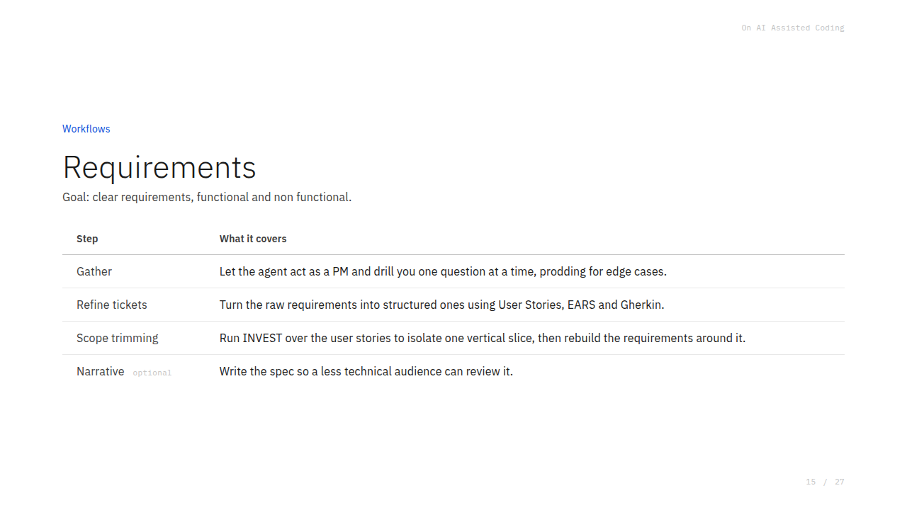
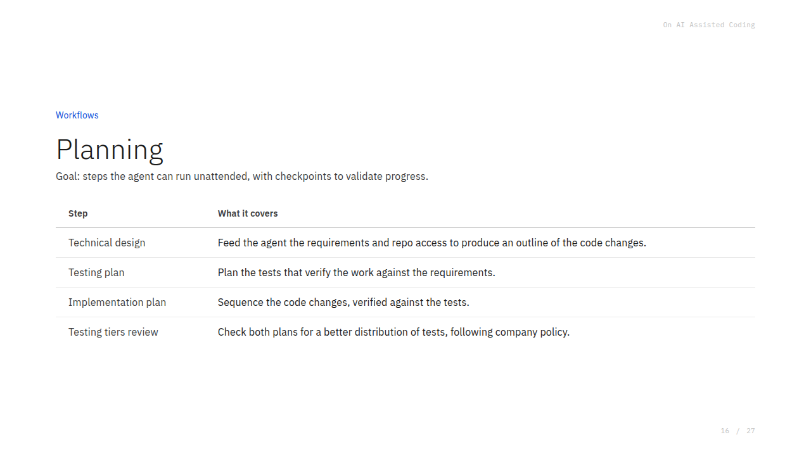
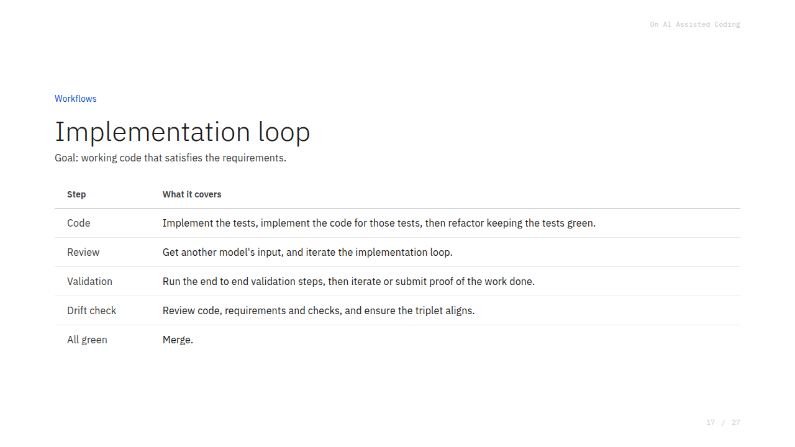
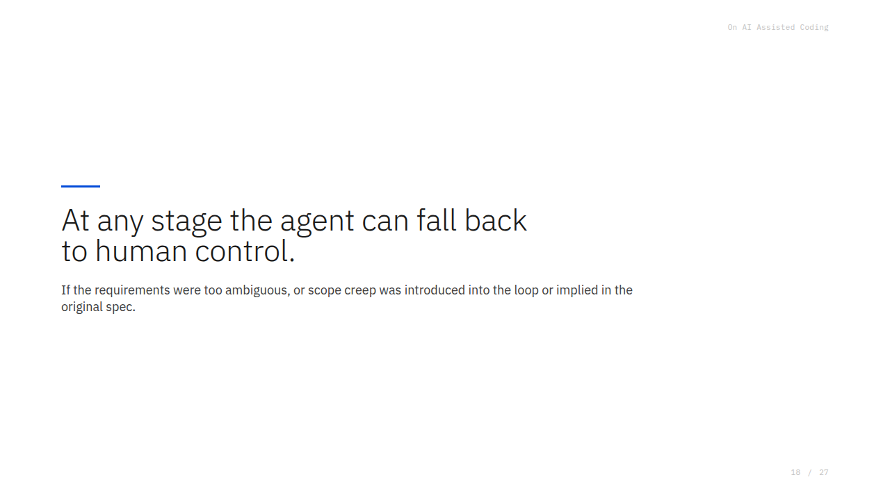
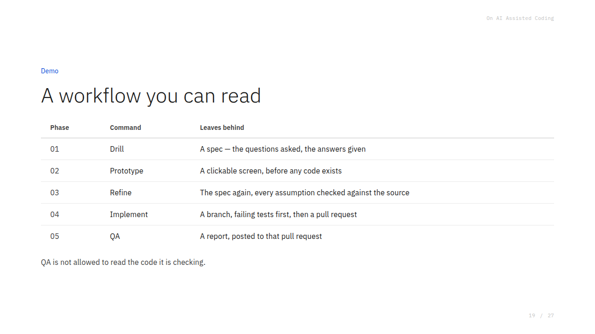
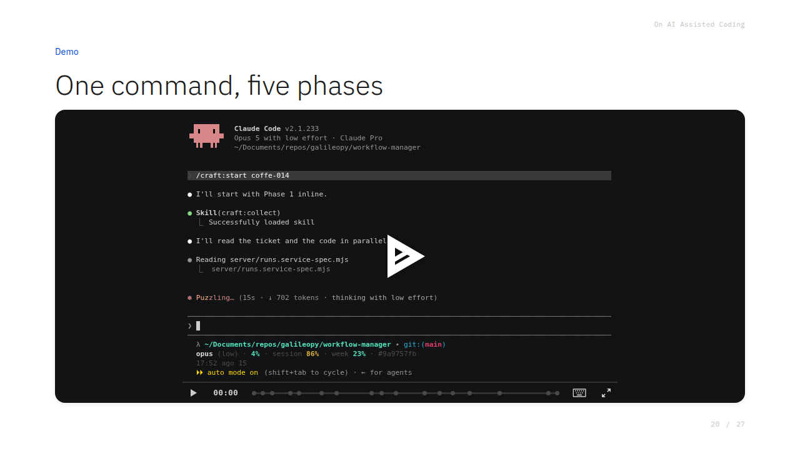
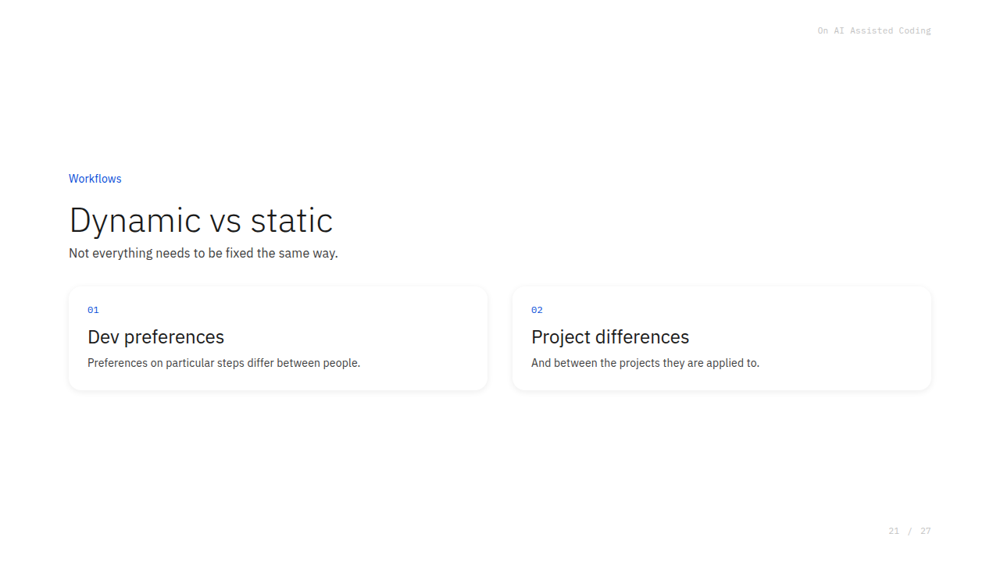

> This is part 2 of three, from a talk I gave on how my coding loop changed this year. [Part 1](/on-ai-assisted-coding-part-1/) covers the feedback loop, [part 2](/on-ai-assisted-coding-part-2/) covers workflows, and [part 3](/on-ai-assisted-coding-part-3/) covers everything else. The slides are [here]({{ site.baseurl }}/presentations/ai-assisted-coding-intro/).

## Three runs at the same goal

Same goal, three runs. What changes is when the correction was authored.

In the first run you **correct as you go**: manual prompting in chat, because you still know the code better. In the second you **plan first and then execute**: you prompt a plan into existence, and correct only when it deviates. That plan can be a `plan.md`, a tool's plan mode, or an LLM-generated self-contained prompt that encodes the goal, the checkpoints, and how to verify them. In the third you have a **reusable workflow**: a pre-set skill per step, collected in an orchestrator prompt that knows how to use them. And as a bonus, a skill that composes the workflow dynamically according to the problem.

In the diagram, a filled dot is manual prompting or intervention. A diamond is the agent self-healing with automated validation: a test, a compile, a QA pass. A dotted outline is a pre-built steering artifact, part of a bigger workflow.

## Workflow

A workflow is a predefined set of steps to follow during implementation. It has three stages: requirements, planning, and the implementation loop.

The goal of the requirements stage is clear requirements, functional and non-functional. You **gather** them by letting the agent act as a PM and drill you one question at a time, prodding for edge cases. You **refine the tickets**, turning the raw requirements into structured ones using user stories, EARS and Gherkin. You do **scope trimming**: run INVEST over the user stories to isolate one vertical slice, then rebuild the requirements around it. And optionally you write a **narrative**, the spec written so a less technical audience can review it. There is no industry standard for that last one; I took Joel Spolsky's four-part series on writing functional specs and condensed it into a skill.

Planning is four steps. The **technical design**: feed the agent the requirements and repo access to produce an outline of the code changes. The **testing plan**: plan the tests that verify the work against the requirements. The **implementation plan**: sequence the code changes, verified against the tests. And a **testing tiers review**: check both plans for a better distribution of tests, following company policy, whether that is integration first, the testing pyramid, the testing trophy, or end-to-end only.

Then the implementation loop. **Code**: implement the tests, implement the code for those tests, then refactor keeping the tests green. **Review**: get another model's input and iterate the implementation loop. **Validation**: run the end-to-end validation steps, then iterate or submit proof of the work done. **Drift check**: review code, requirements and checks, and ensure the triplet aligns. All green, merge.

The loop repeats, so learn from the plans and build stencils for recurring patterns: unit tests, integration tests, endpoints, controllers, resolvers. The refactor step is also where your clean code practices live: general authoring practices, object-oriented preferences, and the local preferences that traditional lint checks and deterministic tooling cannot enforce.

At any stage the agent can fall back to human control, if the requirements were too ambiguous or scope creep was introduced into the loop or implied in the original spec.

## The demo

I built a simplified demo, with no CI and none of the professional-environment scaffolding, using a Linear ticket and a Claude Code setup. Disclaimer: it's a fictional feature in a fictional workflow-management app, so don't scrutinize what it does.

The original request: "I only have the endpoint to create a run; I want to do it from the web page. Whenever I add a new run, keep it inline in the runs space, no new screen, just a text box where I type, hit enter, and it creates a run, with the list of runs on the same screen." A list with a sublist.

I wrapped this in a **Craft loop**, a backronym for Collect, Render, Audit, Forge, Test:

- **Collect** the requirements.
- **Render** them into a clickable prototype.
- **Audit** the prototype and refine, stepping over the initial requirements.
- **Forge** the code.
- **Test.**

Five phases, five checked-in commands. Each one leaves an artifact: **drill** leaves a spec, with the questions asked and the answers given; **prototype** leaves a clickable screen, before any code exists; **refine** leaves the spec again, every assumption checked against the source; **implement** leaves a branch, failing tests first, then a pull request; **QA** leaves a report, posted to that pull request. QA is not allowed to read the code it is checking. The workflow is versioned, reviewable, and someone else can run it.

What happened, step by step:

1. It read the code and the ticket in parallel, then asked clarifying questions, for example "do you want to allow submitting empty steps?" It refuses empty steps. Those clarifications became the expanded requirements.
2. **Collect:** it wrote the decisions and acceptance criteria, and what's out of scope, as a Linear comment.
3. **Render:** it built a prototype as an HTML file: empty state, one-run state, many-runs-with-failures state, success-on-create.
4. **Audit:** it used the prototype, found contradictions in the original acceptance criteria, and refined them away. From here it ran largely unattended.
5. **Forge:** it coded the single-server, single-page app. This implementation-step skill is where you'd encode your preferences for back-end, infrastructure, front-end, and function style. I didn't write any of these skills or plugins; I just told it the steps I wanted, clarify then prototype then refine then implement, and had it generate them. All vibe-coded.
6. It ran tests, committed, and opened the MR. The MR describes what changed and which acceptance criteria it met. No server change was needed here, because the POST-to-create-run endpoint already existed.
7. **QA:** it ran a serverless Playwright pass, a headless browser clicking around, and attached the proof-of-work screenshots to Linear. Attachments go on Linear rather than GitHub because Git doesn't allow attachments via the command line. Then it reported that everything was submitted for review.

Everything in the Linear ticket came from this one session. The QA attachments are the agent's proof of work: "to develop this feature, I clicked here, entered this valid and invalid value, and got this result." You can bake QA into a custom loop or into CI. I prefer the loop, because CI charges per token, which is far more expensive.

The artifacts from that run are public: the [pull request](https://github.com/galileopy/workflow-manager/pull/1) and the [workflow-manager repo](https://github.com/galileopy/workflow-manager) it lives in.

**Requirement drift check.** We keep requirements next to the code in the same repo, so every MR or PR can do a drift check across the triplet: code matches test, test matches requirements. If a change oversteps another requirement, it falls back to a human for disambiguation; if everything's green, it merges. And at any stage, if the agent hits ambiguity it can't resolve, you can code the workflow to release control with a hard stop: "I can't go past this, some gate isn't working."

You can also make the workflow react to the kind of feature: back-end gets one workflow, front-end gets a Playwright end-to-end flow, load-sensitive work runs a k6 suite. A dynamic workflow can first study what needs doing and pick the right skills, in the right order. Not everything needs to be fixed the same way, and the differences come both from developer preferences and from the projects themselves.

### Audience question: how clear must the initial requirements be?

> Jose: How clear a requirement set or product vision do you need before setting the first plan?

It varies a lot by team. I work in a project with very loose definitions of done, so I do a lot of gathering work with the agents. You need enough clarity to know how things flow through a feature, and to recognize when the agent asks a question that doesn't apply, for instance about a state the user can never reach because of your validations. Beyond a rough idea of what won't pass validation downstream, you don't need much more.

> Follow-up: I'm trying to set up self-healing loops. I develop from an initial idea, take it to my product team, and often start with about 3,000 lines of code, that's me wireframing. Wireframing is cheap in the vibe-coded state; if it's accepted, I refactor and create tickets. How do I apply your approach?

That's advanced. Ron warned me these folks aren't so advanced, but this already is. If you're building a prototype to validate requirements, that's the best way: something clickable and a bit dumb, with no backend, just screens. I like to make them a little appealing with HTML and styling. Let it walk the screens and capture edge cases, and document everything.

But don't stop there: use the prototype to produce a **narrative specification**. "Walk me through the user stories, and make sure each one mentions this." User stories, "as an actor, I want an action so that I achieve an outcome"; **EARS** for encoding requirements in disciplined English; and **Gherkin**, from BDD, a way to specify scenarios for tests. Put the validated prototype into text rather than making the AI reverse-engineer it. Usually you only need to validate the user stories, not the verbose EARS and Gherkin, which mostly cover edge and failure cases. Then make sure your implementation loops have the steps your organization wants.

## From requirements to shipped code

You can often bypass explicit planning, because the agent is good at planning for itself. Planning matters more with awkward setups, say a distributed monolith that's hard to navigate; there you might plan, and also ask "how do I redesign this so it needs less babysitting?" But that's a separate topic.

With requirements in hand, ask for a **technical implementation plan** and correct the decisions only you have the history and context for: which webhook belongs at which endpoint versus a serverless handler, organization-specific query choices. Then have a **testing plan** where you bake in TDD.

I strongly recommend a TDD-first testing plan: once it starts, you can read the tests directly in the MR. I spend a lot of effort keeping tests **non-spurious and readable**, not a million tests for a one-line change, but one per user story or scenario. Tests shouldn't become another piece of unmaintainable code. Readable tests help your review and help an agent reviewer. So: write the test, make it pass, refactor with your preferences encoded in a skill, and submit for review, connecting to GitHub, or to GitLab via its CLI tool so you don't pay for GitLab Duo.

For **validation**, have a well-structured end-to-end system: with Playwright and an ephemeral backend environment, the agent spins up a headless Chrome, clicks around, and compares against the approved prototype. "Here's the approved thing, here's the real one, how do they differ?" Agents are good at catching nonsense, padding, a pixel off, wrong wording, and "I clicked and nothing happened." Let it generate a QA paper trail, on Linear or in commit history.

[Part 3](/on-ai-assisted-coding-part-3/) covers the tricks, the links, and everything else the loop is good for.
