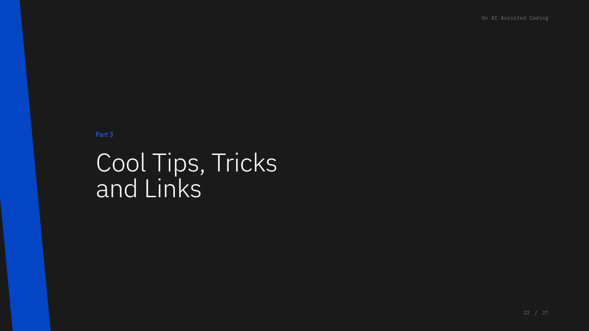
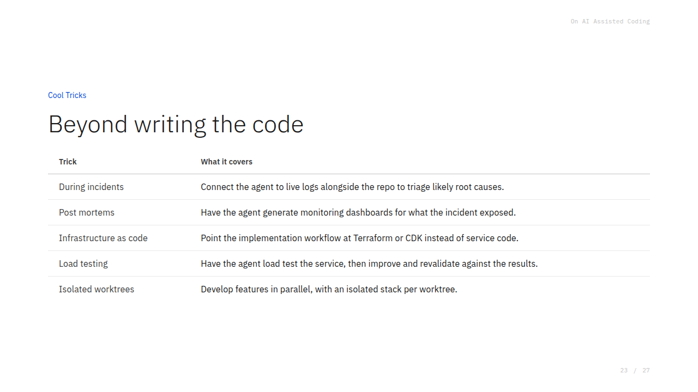
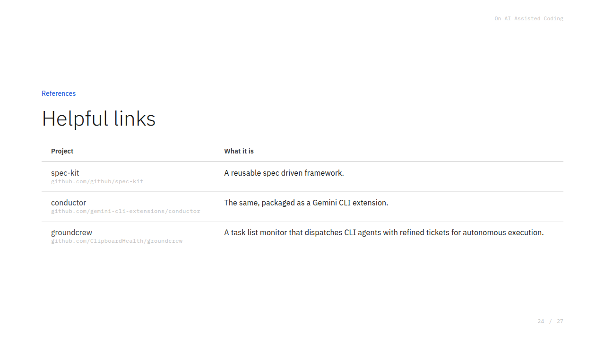
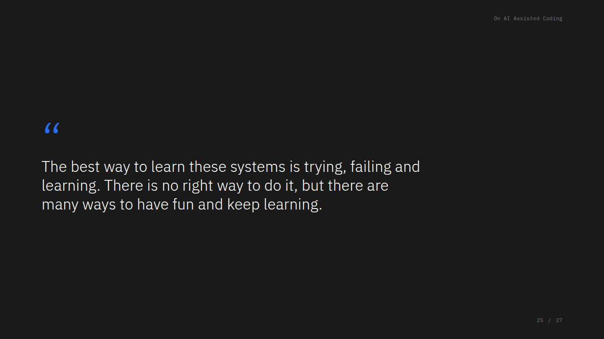

> This is part 3 of three, from a talk I gave on how my coding loop changed this year. [Part 1](/on-ai-assisted-coding-part-1/) covers the feedback loop, [part 2](/on-ai-assisted-coding-part-2/) covers workflows, and [part 3](/on-ai-assisted-coding-part-3/) covers everything else. The slides are [here]({{ site.baseurl }}/presentations/ai-assisted-coding-intro/).

## Other high-leverage uses

**Incidents.** An agent that moves through your code quickly and infers things, connected to your logs (Datadog, Grafana, LogCLI), can help triage incidents: "this service is affected, here's how to get the logs, tell me what's wrong." It loves red herrings, it's maybe 50% useful, so keep your normal incident rituals, but every other incident it may find the real cause. When you know the cause, have it collect evidence and draft the post-mortem and root cause; that gives you a better starting point for a five-whys, with real references to log lines.

**Infrastructure code.** Generating Terraform or CDK is one of the easiest wins, because you don't add infra every day and your devops team already has strong conventions around it.

**Performance and load testing.** Running the loop against load tests once let me scale a service ~100x. It was already using **ClickHouse**, but the queries were very inefficient, and the agent was good at fixing them. For a critical service that's slow, get it onto a proper self-running test bench, find where it fails, and optimize; there's a lot of mileage there.

**Parallelism.** Using git worktrees, you can spin up multiple instances of your service, each agent working its own feature on its own isolated worktree with the full stack running: five features a night instead of one. You then need time to QA them, which may even bring QA back as a profession.

**Orchestration, "Ground Crew."** The link I'd most encourage you to look at is Ground Crew: an orchestrator that pings your Linear tickets, finds the ones ready to be fully offloaded to an agent, and starts a **tmux** session (a terminal multiplexer, like a screen session that doesn't tie up your terminal, letting you run many terminals without a wall of windows). Set it up and Ground Crew works overnight, respecting your usage limits.

## Links

- [spec-kit](https://github.com/github/spec-kit): a reusable spec driven framework.
- [conductor](https://github.com/gemini-cli-extensions/conductor): the same, packaged as a Gemini CLI extension.
- [groundcrew](https://github.com/ClipboardHealth/groundcrew): a task list monitor that dispatches CLI agents with refined tickets for autonomous execution. This is the link I'd most encourage you to look at.

## Closing thought

What helped me most was not taking it too seriously: having fun and finding the best way for *me* to trust these systems, rather than breaking my head over how to build the perfect orchestrator or the ultimate super-agent. Do your thing the way you enjoy it, then delegate what you don't want to do. I don't want to do QA or validate that the tests match the requirements, but I do want to understand what the user wants, and I do want to be sure my code works, because I don't want to ship something that breaks.

The best way to learn these systems is trying, failing and learning. There is no right way to do it, but there are many ways to have fun and keep learning.

## Questions

> **From the audience:** Do the workflows and agents account for potentially dangerous or destructive actions, and how do you reconcile that with a hands-off approach?

Two or three things matter. First, I wouldn't let it install dependencies: treat dependencies with the same scrutiny as always, and rely heavily on pinning. With Claude, the auto mode is very safe; I'd never recommend "dangerously skip permissions", the current gatekeeper is very good and still allows a lot of hands-off work. Second, when gathering requirements, don't let it browse the web freely, work locally on a Markdown document.

Those eliminate most of the attack vectors, because prompt injection comes in either through a bad dependency or through deep research on the web leaking malicious content into your documents. So review your requirements thoroughly, and read them through something plain ASCII, a text reader or VS Code, not a rich-text viewer, so you can see every character as it is. If you used deep research to generate documents that will be handed to an unattended agent, check that output carefully. Beyond that we haven't had many issues.

My own bigger concern isn't the outside-in vectors (dependencies, prompt injection) but inside-out dangerous actions, like spawning processes. For that you can run the CLI inside a Docker sandbox; the most security-savvy people on our team go all the way with that.

> **From the audience:** For back-end work that isn't verifiable through the UI, where the agent might produce sloppy or inefficient architecture, do you use any performance-type testing or other tools?

We tackle it at two levels. First, an internal tool describes a change with its requirements and plan, and embeds **SVG/Mermaid diagrams** of the intended architecture (most Markdown readers render embedded Mermaid), so you can make the technical-design step more thorough and refine the design.

Second, split requirements into **functional** (what the user clicks) and **non-functional** (performance criteria, for example "run under 1,000 requests a minute"). If your skills must validate each requirement against a passing test, the agent will either propose a **load test** or you tell it that's how to validate.

A step I didn't have time to show: quickly spinning up a full end-to-end local stack, a `start` that brings up the database and every Dockerized dependency, mocking what isn't Dockerizable, so you can test end-to-end with a curl request and then run a load test (for example, **k6**) for a massive request volume. Once that self-bootstraps, load-test requirements become part of your non-functional requirements, validated during the validation step. Those tests are expensive and slow, so we only run them on endpoints that have proven slow before.

So: non-functional requirements, load tests, and a vibe-check of the architecture diagrams for high-requirement problems.
